I'm a **Systems Analysis and Development graduate**, working in **DevOps at Chinalink**. I build backend systems and developer tools, and develop games with **Unity** and **Unreal Engine 5**. I'm also continuing my cybersecurity studies.

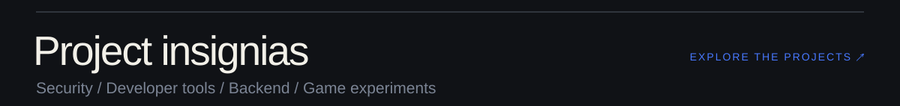

<!-- PROJECTS:START -->

  <a href="https://github.com/Buraddomoon/AEGIS">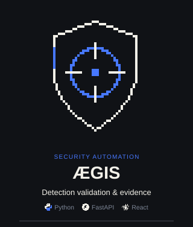</a>
  <a href="https://github.com/Buraddomoon/reversible-debugger">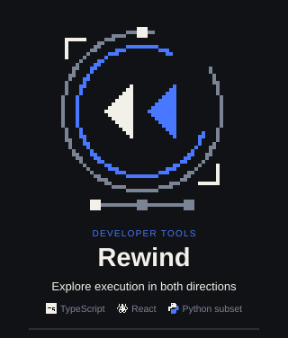</a>
  <a href="https://github.com/Buraddomoon/Hackaton-T2S">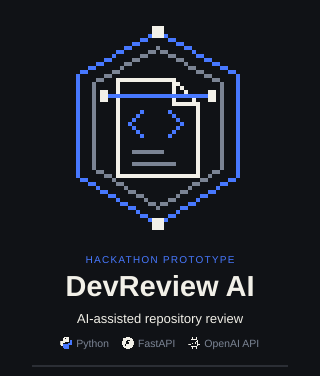</a>
  <a href="https://github.com/Buraddomoon/FirebaseForms">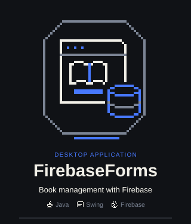</a>
  <a href="https://github.com/Buraddomoon/2D-Unity">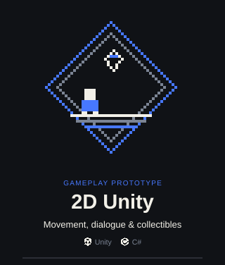</a>
  <a href="https://github.com/Buraddomoon/Tarefas-API">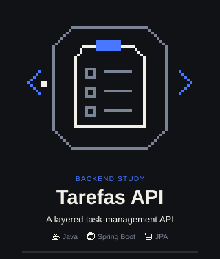</a>

<a href="https://github.com/Buraddomoon?tab=repositories">Explore all repositories ↗</a>

Project index &amp; technical notes

- [**ÆGIS**](https://github.com/Buraddomoon/AEGIS) — Purple team automation with scoped campaigns, approvals, telemetry correlation and traceable evidence.
- [**Rewind**](https://github.com/Buraddomoon/reversible-debugger) — A visual reversible debugger with a Python-subset interpreter, delta history, sparse checkpoints and execution comparison.
- [**DevReview AI**](https://github.com/Buraddomoon/Hackaton-T2S) — A DragonsHacka 2025 prototype that clones a GitHub repository and generates AI feedback from its README. Structure and source-code analysis helpers are still placeholders.
- [**FirebaseForms**](https://github.com/Buraddomoon/FirebaseForms) — A desktop book manager with Java Swing forms and create, search, update and delete operations backed by Firebase Realtime Database.
- [**2D Unity**](https://github.com/Buraddomoon/2D-Unity) — A 2D gameplay prototype with movement, double jumps, NPC dialogue, collectibles and falling platforms.
- [**Tarefas API**](https://github.com/Buraddomoon/Tarefas-API) — A task-management REST API with controllers, services, DTOs, mappers and a Spring Data JPA repository.

[ÆGIS architecture](https://github.com/Buraddomoon/AEGIS/blob/main/docs/architecture/overview.md) · [Rewind architecture](https://github.com/Buraddomoon/reversible-debugger/blob/main/docs/architecture.md)

<!-- PROJECTS:END -->

 

<picture>
  <source media="(max-width: 600px)" srcset="./assets/toolbox-mobile.svg" />
  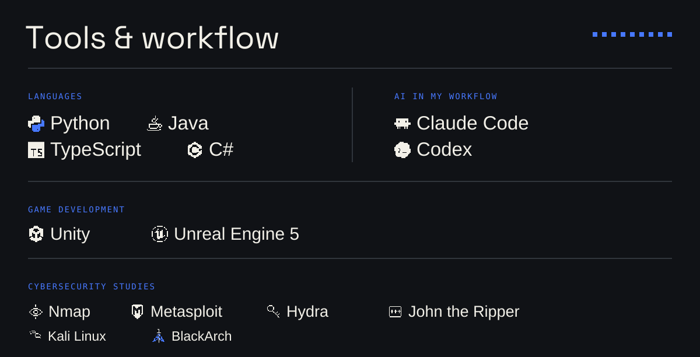
</picture>

Tools in text

| Area | Tools |
| :--- | :--- |
| Languages | Python · Java · TypeScript · C# |
| AI in my workflow | Claude Code · Codex |
| Game development | Unity · Unreal Engine 5 |
| Cybersecurity studies | Nmap · Metasploit · Hydra · John the Ripper |
| Learning environments | Kali Linux · BlackArch |

 


<a href="https://www.linkedin.com/in/fabio-lopes-31b46a373">
  
</a>

Open to collaboration on **backend systems**, **developer tools**, and **detection validation**. Architecture feedback, test cases, and reproducible bug reports are welcome.

[LinkedIn](https://www.linkedin.com/in/fabio-lopes-31b46a373) · [ÆGIS issues](https://github.com/Buraddomoon/AEGIS/issues) · [Rewind issues](https://github.com/Buraddomoon/reversible-debugger/issues)
